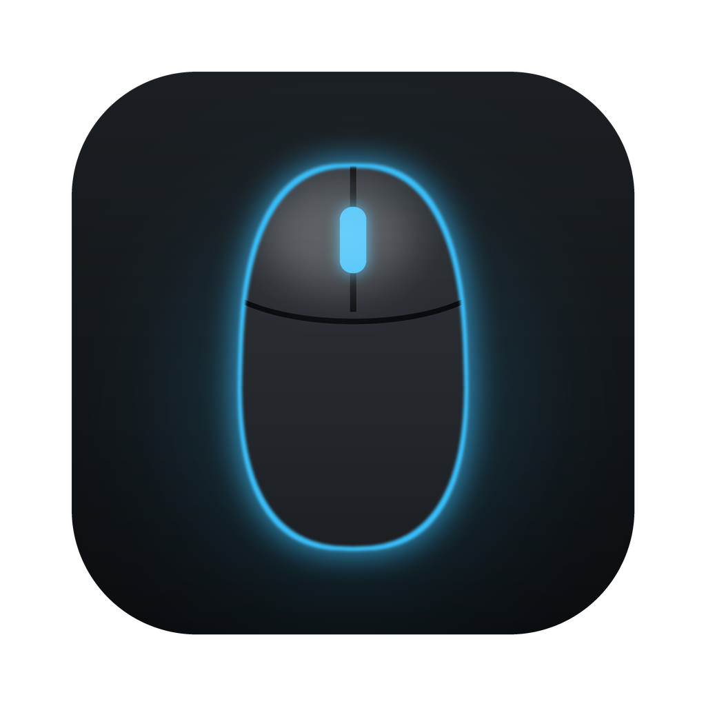
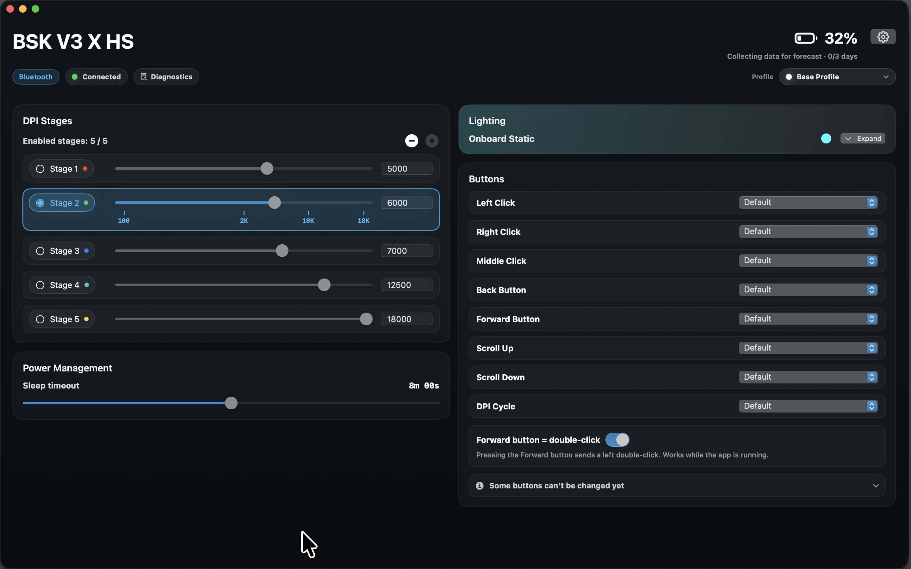
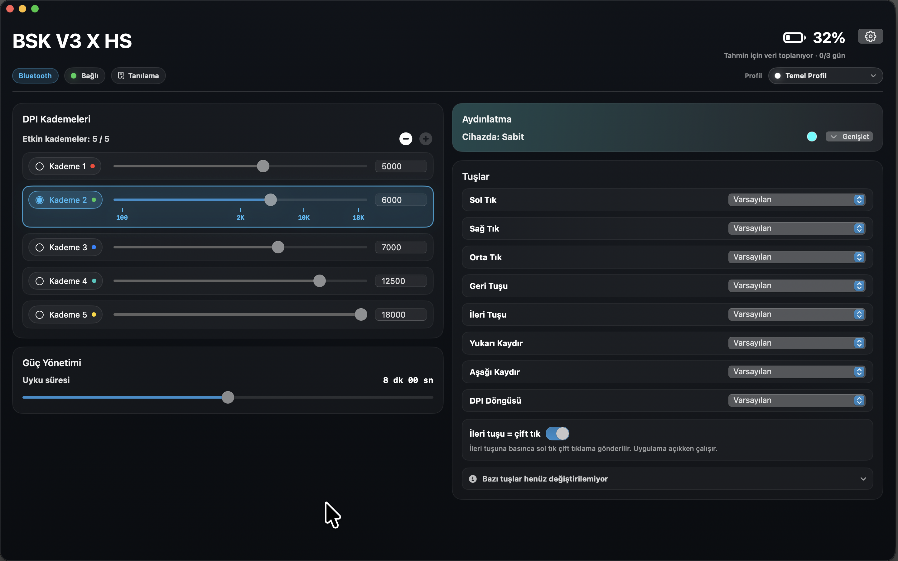

<!-- MouseTune fork -->
<p align="center">
  
</p>

<h1 align="center">MouseTune</h1>

<p align="center">
  A personal fork of <a href="https://github.com/gh123man/OpenSnek">OpenSnek</a> by gh123man and the OpenSnek contributors.
</p>

> **This is a fork, not an original project.** Almost all of the code, protocol research and device support comes from
> [OpenSnek](https://github.com/gh123man/OpenSnek). This fork only adds the changes listed below. If you want the
> maintained app, use upstream OpenSnek.



<details>
<summary>Turkish interface</summary>



</details>

## What this fork changes

- **Bluetooth battery fix (Basilisk V3 X HyperSpeed):** the vendor battery value is always read on a 0-255 scale over
  Bluetooth. Upstream treated raw values up to 100 as a percentage, so a raw `0x52` (82) showed 82% instead of 32%.
  Covered by tests in `BridgeClientBluetoothFallbackTests`.
- **Battery history and forecast:** battery readings are stored locally and used to estimate the days of battery left,
  shown under the battery percentage and in the menu bar (`BatteryHistory.swift`, `BatteryForecastLabel.swift`).
- **Forward button double-click:** optional toggle that turns the Forward button into a left double-click using a
  macOS event tap; needs Accessibility permission (`ForwardDoubleClick.swift`).
- **Name and icon:** the app is shown as "MouseTune" with its own icon, and logs go to `~/Library/Logs/MouseTune`.
  Update checks are disabled because this fork has no release feed.
- **Layout tweaks:** no device sidebar (the device name in the header switches devices when more than one is
  connected, and the settings gear sits top-right), compact one-line DPI stages, cards that fill the shorter column,
  a compact single-page Settings window, Diagnostics next to the connection status, and the "some buttons can't be
  changed yet" note collapsed by default.
- **Turkish interface:** on-screen text is translated through `OpenSnekCore/Localization.swift` and
  `App/Resources/tr.lproj`. Settings > Language switches between System, Türkçe and English (applies after
  reopening the app). Low-level device error messages and diagnostics stay in English.
- **Local build script:** `build_mousetune.sh` builds and installs `MouseTune.app`.

Every modified upstream file carries a "Modified in the MouseTune fork" note at the top.

## Building

Requires macOS 14 or later and Xcode. From the repository root:

```bash
./build_mousetune.sh
```

The script builds an ad-hoc signed `MouseTune.app`, installs it to `/Applications` and opens it. It replaces an
existing `/Applications/MouseTune.app`.

## License and attribution

Licensed under the [Apache License 2.0](LICENSE), the same license as upstream. Original work: Copyright 2026 OpenSnek
contributors. Changes in this fork: Copyright 2026 mustafacicek-eee.

## Sponsoring

The Sponsor button on this repository supports the work in this fork (the changes listed above). OpenSnek itself is
built and maintained by gh123man and its contributors; see the [upstream repository](https://github.com/gh123man/OpenSnek).

## Trademarks

MouseTune is an independent project. It is not affiliated with, endorsed by or sponsored by Razer or by the OpenSnek
project. Razer, Basilisk, Synapse and other product names are trademarks of their respective owners and are used here
only to identify compatible hardware.

---

# Upstream OpenSnek README

The text below is the original OpenSnek README, kept for reference. Links and download buttons point to upstream.

<h1 align="center">OpenSnek</h1>

<p align="center">
  Configure supported Razer mice on macOS without Synapse, Windows, or vendor lock-in.
</p>

<h2 align="center"><a href="https://github.com/gh123man/OpenSnek/releases">Download</a></h2>


OpenSnek is an open source native macOS app for configuring supported Razer mice over USB or Bluetooth, with early lighting-only support for select Razer keyboards and keypads.

## Highlights

- Lightweight native macOS app bundle with no unnecessary runtime bloat
- Very low idle and background overhead, so it stays out of the way when you are not using it
- Optional menu bar control for quick, on-the-fly DPI adjustments  
  
- Manage onboard profiles on supported devices  
  
- Rebind all supported mouse buttons and write to onboard storage  
  

## Supported Devices

Support is transport-specific. A mouse may be supported over USB, Bluetooth, or both, depending on what has been captured, tested, and validated in the app.

| Device | USB | Bluetooth | Notes |
|---|---|---|---|
| Basilisk V3 X HyperSpeed | Validated | Validated | |
| Basilisk V3 | Mapped | No | OpenRazer-backed USB profile, sharing the Basilisk V3 USB family configuration with a `26,000` DPI ceiling |
| Basilisk V3 Pro | Validated | Validated | |
| Basilisk V3 35K | Validated | No | Shares the Basilisk V3 USB family configuration |
| Orochi V2 | Not yet | Contributor validated | Contributor validated Bluetooth DPI stages and battery; button remap is profile-mapped pending hardware readback validation. 2.4 GHz HyperSpeed dongle not yet supported. Mouse has no RGB lighting. |
| Basilisk (2017) | Contributor validated | No | Contributor validated DPI (scalar, X/Y, live 5-stage table), poll-rate reads, and logo/scroll lighting; button remap not yet mapped |
| Lancehead Tournament Edition | Contributor validated | No | Contributor validated DPI (scalar, X/Y, live 5-stage table), poll-rate reads, and all four lighting zones; button remap not yet mapped |
| Huntsman Mini | Contributor validated | No | Keyboard: contributor validated backlight lighting and brightness. First non-mouse profile; key remap not supported |
| Tartarus Pro | Contributor validated | No | Keypad: contributor validated backlight lighting and brightness. Analog actuation and key remap have no public protocol |

Status key:
- `Validated` = supported and locally capture/test validated in OpenSnek
- `Contributor validated` = support is based on external contributor hardware validation and has not been locally validated by OpenSnek maintainers
- `Mapped` = supported through a shipped profile, but not yet locally validated on OpenSnek hardware
- `Not yet` = the transport exists on the hardware but OpenSnek does not support it yet
- `No` = that transport is not available on the device

Not every feature is fully supported on every listed transport yet. Some controls and readback paths are still partial while capture, testing, and validation continue.

Support docs:
- Per-device USB/BT feature matrix: [docs/DEVICE_SUPPORT.md](docs/DEVICE_SUPPORT.md)
- Getting started with new device support: [docs/development/ADDING_DEVICE_SUPPORT.md](docs/development/ADDING_DEVICE_SUPPORT.md)
- Protocol and transport docs: [docs/protocol/PROTOCOL.md](docs/protocol/PROTOCOL.md)
- Contribution and new-device workflow: [CONTRIBUTING.md](CONTRIBUTING.md)

Unsupported Razer mice still get a best-effort experience when possible. OpenSnek will probe for controls that already match known behavior, show a light warning that the device is not fully supported, and avoid exposing UI for features that have not been mapped safely yet.

Support for more devices is welcome. New device support can land either through outside contributors or as more hardware becomes available for capture, testing, and validation.

## Motivation

Razer does not support the Basilisk V3 X HyperSpeed on macOS at all, so this project started by reverse engineering the BLE protocol from Windows traffic between the mouse and Synapse.

The goal is simple: make supported Razer mice configurable on macOS without needing Synapse, Windows, or a second machine just to change settings.

More device support is welcome, whether that comes from new hardware captures or pull requests. For USB protocol reference work, this project also builds on the excellent documentation and reverse-engineering effort from [OpenRazer](https://github.com/openrazer/openrazer).

## Features

- Change DPI, stage count, and active stage
- Adjusts supported lighting settings
- Remaps supported buttons
- Works over USB and Bluetooth where the device protocol allows it
- Avoids the need for Synapse or a separate Windows machine

## Download and Install

1. Download the latest DMG from [GitHub Releases](https://github.com/gh123man/OpenSnek/releases).
2. Open the DMG.
3. Drag `OpenSnek.app` into `Applications`.
4. Launch `OpenSnek`.

Official builds use the latest Xcode/macOS SDK. Local source builds can use
either full Xcode or Command Line Tools. Minimum supported macOS version:
macOS 14.

If macOS asks for permissions:

- For USB control, grant `Input Monitoring` to `OpenSnek` in `System Settings > Privacy & Security`.
- For Bluetooth control, allow Bluetooth access when prompted.

## Build From Source

From the repo root:

```bash
./run.sh
```

With full Xcode, that rebuilds the canonical `OpenSnek.app` target. On a
Command Line Tools-only Mac, it builds with SwiftPM and assembles the same
stable `.dist` app bundle before launching it through
`OpenSnek/scripts/run_macos_app.sh`. If Command Line Tools provides an older
Swift than the package requires, install the current toolchain with
`brew install swift`; the script detects it without changing `xcode-select` or
`PATH`.

If you want to reuse the current app bundle without rebuilding:

```bash
./run.sh --no-build
```

## Build

```bash
swift build --package-path OpenSnek
```

Direct SwiftPM commands require Swift 6.2 or newer. After `brew install swift`,
either call `/opt/homebrew/opt/swift/bin/swift` directly on Apple silicon or
prepend the Homebrew Swift directory to `PATH`.

## Test

```bash
swift test --package-path OpenSnek
```

Running tests with the above command as-is still requires a full Xcode installation
due to XCTest, but if desired, it is possible to run the test suite on a machine with
only Xcode CLT installed, by extracting XCTest from an Xcode .xip for standalone
usage and pointing swift test to it, but due to the non-reproducible nature of
that procedure, caused by the need to match the Xcode version XCTest is extracted
from to the user's installed Xcode CLT version, which differs by macOS version,
that process will not be documented in detail here, other than noting it can be achieved.

## Xcode

```bash
./OpenSnek/scripts/generate_xcodeproj.sh --open
```

`OpenSnek/OpenSnek.xcodeproj` is generated from `OpenSnek/project.yml` on demand and is not checked into git.

## Project Docs

- App build, run, probe, and validation details: [OpenSnek/README.md](OpenSnek/README.md)
- Device support and reverse-engineering workflow: [CONTRIBUTING.md](CONTRIBUTING.md)
- Getting started with new device support: [docs/development/ADDING_DEVICE_SUPPORT.md](docs/development/ADDING_DEVICE_SUPPORT.md)
- Device support matrix by feature and transport: [docs/DEVICE_SUPPORT.md](docs/DEVICE_SUPPORT.md)
- DMG release and notarization setup: [docs/release/DMG_RELEASE.md](docs/release/DMG_RELEASE.md)
- Protocol documentation: [docs/protocol/PROTOCOL.md](docs/protocol/PROTOCOL.md)
- Kraken Kitty V2 research (unsupported on macOS): [protocol and transport findings](docs/research/KRAKEN_KITTY_V2_MACOS_TRANSPORT_FINDINGS.md)
- Supported Python tooling: [tools/python/README.md](tools/python/README.md)
- BLE capture corpus: [captures/README.md](captures/README.md)

## License

This repository is licensed under the Apache License 2.0. See [LICENSE](LICENSE).
